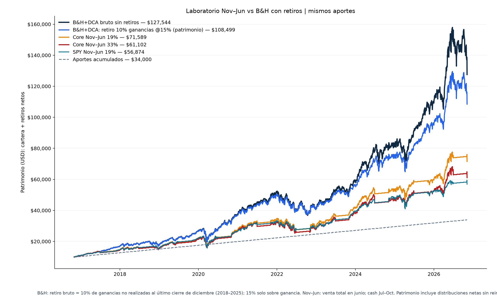
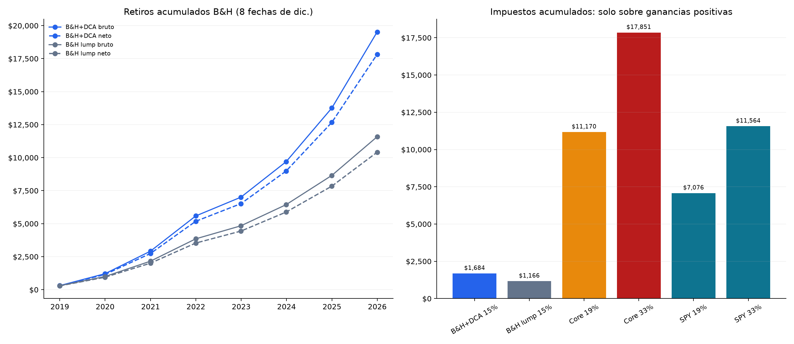

# Comprar y mantener con retiro gradual vs Nov–Jun

> **Reconstrucción retrospectiva educativa con pesos actuales. No es el historial de una cuenta real ni una recomendación para cambiar el core.**

Laboratorio Python/Jupyter **event-driven** para comparar: (a) buy-and-hold que
retira **10% de ganancias acumuladas cada diciembre**, (b) estrategia Nov→Jun con
venta total anual. Impuesto solo sobre la **ganancia realizada**, jamás capital
aportado. Reconstrucción desde cierre ajustado Yahoo, cache Parquet reproducible
offline, funciones explicadas y ejecutadas en IPYNB, pruebas y SQL DuckDB.

**Autor:** Andalejo1109 · **Licencia:** MIT · [Notebook ejecutado](notebooks/analisis.ipynb).

[](https://colab.research.google.com/github/Andalejo1109/inversion-largo-plazo-vs-market-timing/blob/main/notebooks/analisis.ipynb)

## Advertencia antes de interpretar

- **Pesos actuales mirando atrás:** SPYG 31%, SMH 22%, BRK.B 20%, IEMG 20%, VTI 7%.
No representan movimientos reales recibidos ni una trayectoria conocida ex-ante. Hay
sesgo retrospectivo, de selección y composición.
- El período y selección no prueban universalmente que Nov–Jun falle, ni concluyen
que el tuit sea falso. La selección de años cada cuatro puede corresponder a
midterms; **este contraste es anual y tiene otra hipótesis**.
- **Tasas fiscales solo sensibilidades educativas aportadas por el usuario**: B&H
15% ganancia ocasional, Nov→Jun 19%/33% ordinaria. No son tarifas universales
verificadas ni asesoría fiscal. Se calcula en **USD**, **no en COP** ni una
declaración tributaria de Colombia.
- B&H DCA simplifica elegibilidad ≥2 años a nivel del plan, **sin clasificar
antigüedad por lote**. Existen aportes recientes de menos de dos años en DCA.
- Retiro efectivo **vende unidades**: la distribución incluye recuperación de coste
no imponible y ganancia, no ganancia pura. Tributo nunca es `tasa × principal retirado`.

## Datos, aportes y fechas exactas

Datos Yahoo Finance **adjusted close** mediante yfinance en cache: split y splits y
dividendos incorporados mediante reinversión supuesta en precio ajustado, **sin
impuestos por dividendos modelados separadamente**. Todo en USD; BRK.B es `BRK-B`.
Pipeline cache offline no produce secrets ni datos privados de las cuentas.

- Sample: **01-nov-2016 a 05-nov-2026** (último cierre completo disponible).
- Compra inicial en noviembre de 2016; DCA en el primer día bursátil de cada mes.
- Comisión: `cash × b/(10000+b)` al comprar y `gross_sale × b/10000` al vender; 5 bps.
- DCA aporta $10k + $200 ×120 = **$34k**. Lump = **$10k**, sin mensuales. **No se
presenta lump como igualdad de aportes con DCA.** Se separan para contraste distinto.
- Nov→Jun: compra desde primer bursátil noviembre y vende todo al cierre último
bursátil junio (cash jul–oct al 0%). Base de coste reiniciada en recompra noviembre.
- Sample termina 5-nov-2026, abierto 2026/27 sin anticipar junio 2027.

### Motor de coste y ganancia, para reproducir leyendo el notebook

Cada activo tiene unidades q_i y coste promedio b_i. Al comprar
`q_i += allocation_i / adjusted_close_i`, actualizando b_i. `B = Σ q_i b_i`.

Para venta parcial a fracción f: `basis_sold = Σ f q_i b_i`.
**Cada evento global**: `G = max(0, proceeds_net − basis_sold)` y `Tributo = tasa × G`.
Las pérdidas neutralizan ganancias en la **misma venta**, sin arrastre de pérdidas.
**No se tasa bruto ni aportes.** Aportes netos IEEE-754 se ajustan con tolerancia
de microredondeo para no activar transacción económicamente imposible en el test
sintético "sin ganancia" (1e-7 ≪ USD).

### Plan B&H anual exacto

Cada **última sesión bursátil de diciembre, 2018–2025**:

`U = valor cartera − coste global`; `retiro bruto = 10% × max(0,U)`_;
`retiro neto = retiro bruto − fee − tax sobre componente ganancia`.

**No es 10% del patrimonio ni retiros fondeados por principal si U≤0.**
El retiro proporcional está formado por coste no imponible y ganancia realizada.
Fechas reales: 31-dic-2018, 31-dic-2019, 31-dic-2020, 31-dic-2021, 30-dic-2022,
29-dic-2023, 31-dic-2024 y 31-dic-2025. Dos años al primer retiro desde 2016;
**no hay retiro de diciembre 2026 por no existir todavía al final del sample**.
B&H no liquida remanente ni cobra impuesto terminal inventado: latente pendiente.

### Patrimonio presentado, no liquidación final

Patrimonio económico = **cartera no liquidada + retiros netos retenidos sin reinversión
al 0%**. Incluye ganancias latentes; **NO es neto liquidable** ni equivale a saldo
tras liquidar todas las posiciones y liquidar impuestos finales.
El XIRR usa aportes negativos, retiros netos **en su fecha**, saldo restante final,
no suma los retiros como si todos llegaran al final del sample.

## Resultados: cifras reales del script

USD; valores exactos en [metrics.csv](output/metrics.csv). `vsCore19/33`: patrimonio
económico menos Core Nov→Jun con esa tasa. **DCA 34k y lump 10k no comparten total aportes.**

| Estrategia | Cartera final NO liquidada | **Patrimonio económico** | XIRR | Impuestos | Retiros brutos / netos | vsCore19 | vsCore33 |
|---|---:|---:|---:|---:|---:|---:|---:|
| **B&H+DCA, 10%U anual @15%** | $90,669.54 | **$108,498.56** | 19.13% | $1,684.01 | $19,522.79 / $17,829.02 | +$36,909.53 | +$47,396.68 |
| B&H lump, 10%U anual @15% | $38,260.10 | $48,673.52 | 19.19% | $1,165.88 | $11,585.10 / $10,413.42 | −$22,915.51 | −$12,428.36 |
| **Core Nov→Jun a 19%** | $71,589.03 | **$71,589.03** | 11.21% | $11,170.06 | 0 / 0 | base | +$10,487.15 |
| **Core Nov→Jun a 33%** | $61,101.88 | **$61,101.88** | 8.86% | $17,850.74 | 0 / 0 | −$10,487.15 | base |
| SPY Nov→Jun a 19% | $56,873.60 | $56,873.60 | 7.80% | $7,075.85 | 0 / 0 | −$14,715.43 | −$4,228.28 |
| SPY Nov→Jun a 33% | $50,682.08 | $50,682.08 | 6.07% | $11,563.72 | 0 / 0 | −$20,906.95 | −$10,419.80 |
| B&H+DCA bruto 0% sin retiros (ancla DCA) | $127,543.95 | $127,543.95 | 19.72% | 0 | 0 / 0 | +$55,954.92 | +$66,442.07 |
| Core Nov→Jun bruto 0% | $88,491.55 | $88,491.55 | 14.33% | 0 | 0 / 0 | +$16,902.53 | +$27,389.68 |
| SPY Nov→Jun bruto 0% | $66,457.86 | $66,457.86 | 10.11% | 0 | 0 / 0 | −$5,131.17 | +$5,355.98 |
| B&H lump bruto 0% sin retiros (ancla lump) | $61,796.00 | $61,796.00 | 19.96% | 0 | 0 / 0 | −$9,793.03 | +$694.12 |

**Reconciliación autoritativa B&H+DCA**:
`90,669.54210235663 + 17,829.017710160348 = 108,498.55981251698`.
Aportes originales aún no distribuidos: `$25,696.70`. Es su **coste contable neto**.
Coste total remanente (incluye ganancias reinvertidas): `$25,696.70`. No “capital seguro”.
**El patrimonio total incluye retiros ya recibidos y posición aún abierta.** Todo verificable en
[withdrawal_schedule.csv](output/withdrawal_schedule.csv), ocho retiros, cada sumatoria
W=10%U con tax/desembolso reconciliado por engine y ETL SQL.

Bajo estos supuestos y selección, B&H+DCA acumula un patrimonio mayor que
Nov–Jun, pero no convierte una década en prueba de una ley de mercado.

## Equity y cash distribuido / impuestos



 

## Ejecutar: offline + sin credenciales

```bash
cd inversion-largo-plazo-vs-market-timing
python3 -m venv .venv
.venv/bin/python -m pip install -r requirements.txt
.venv/bin/python run_backtest.py             # reproduce cache -> outputs
.venv/bin/python notebooks/build_notebook.py # ejecuta celdas y guarda ipynb
.venv/bin/python -m pytest tests/test_engine.py tests/test_sql_etl.py -q
.venv/bin/python sql/etl_duckdb.py            # calidad SQL DuckDB idempotente
```

`--refresh` opcional descarga yfinance (red) y puede revisar valores. No hay datos de broker
ni registro de operaciones de cuentas, ni claves API. `src/data.py` usa el cache de forma predeterminada; refrescar requiere
instalar la dependencia `yfinance`. **No hay `.venv` en el ZIP**: se instala al clonar.

Para Colab: el badge abre ipynb del repositorio. Con los archivos del ZIP puede abrirse en Colab o clonarse el repo; el cache de precios y los scripts acompañan al cuaderno.
El cuaderno funciona en la raíz y busca el directorio padre si se abre en notebooks.

## ETL SQL y pruebas

- `sql/schema.sql` estructura `prices`, `events`, `results`.
- `sql/etl_duckdb.py`: parquet date-by-ticker, eventos de venta y fiscalidad, `research`
schema / views, reconciliación de identidad para cada escenario; sin DB credenciales.
- `sql/queries.sql`: observaciones Yahoo, diferencia monetaria máxima, auditoría de retiros y guardia de impuesto
positivo con ganancia. Database output regenerable, excluded from ZIP.
- `tests/test_engine.py + test_sql_etl.py`: asserts indicators, costs/gain-tax,
2018–2025 withdrawal schedule, base original, banderas de no liquidación, fechas XIRR y caso sintético sin ganancia. Ejecutados localmente según `output/pytest_results.txt`.

**Tests:** la ejecución cerrada tiene **10 verificaciones aprobadas**; detalles y recuento
[pytest_results.txt](output/pytest_results.txt), ETL [etl_validation.txt](output/etl_validation.txt).

## Diferencias respecto a versiones previas (auditoría visible)

1. B&H hace 8 retiros anuales y no venta total al final; su patrimonio es distinto y
NO una sola liquidación tributada al final.
2. El retiro bruto (10% de U) incluye coste y ganancia: solo la ganancia neta (proceeds−basis) es imponible.
En el registro de eventos, cada evento con venta muestra `cost_basis_sold > 0`.
3. La fórmula global max(0,V−B) reemplaza variantes por activo: en la misma venta de junio
neutraliza ganancias/pérdidas. Puede explicar incremento pequeño respecto números
previos. Notebook detalla cambios en outputs, sin ajustar fuente o fechas para objetivo.
4. La base original intermedia `14,628.57` no era correcto; la política de fuente ahora
reconcilia `contribución − fee − coste devuelto` y valor fijo verificado. Misma venta
no altera datos para forzar esos importes.
5. El económico no se etiqueta como NETO LIQUIDABLE; XIRR ordena los flujos en la misma
fecha antes de resolver la tasa. No se doblegó la tasa a un resultado a priori.
El término fiscal depende del lotaje individual y de otros hechos fuera de este laboratorio.

[AUDIT.md](AUDIT.md) deja detalle de pequeños fallos corregidos y limitaciones aceptadas,
sin ocultar divergencias ni usar conectores a las cuentas del usuario.

## Contenido

- `notebooks/analisis.ipynb` ejecutado con formulas + outputs + imágenes embebidas.
- `notebooks/build_notebook.py` reproduce todas las celdas (no sólo `main()`).
- `src/engine.py`: motor eventos/coste/venta/retiro/retención & no-liquid wealth.
- `run_backtest.py`: escenarios, CSV, figura; `src/report.py`.
- `output/*.csv/*.png/validation.txt/etl_validation.txt` auditoría de trabajo.
- `cache/yfinance_adjusted_close.parquet`, `cache/prices_long.parquet`: snapshot compacto.
- `tests/` motor y ETL; `sql/` contratos DuckDB explícitos and .gitignore.
- `artifacts/notebook/`: figuras que notebook exporta para uso reproducible.

Autor Andalejo1109. MIT [LICENSE](LICENSE). Datos públicos de Yahoo sujetos a sus
términos; no incluye imágenes de referencia de terceros. Enlace repo:
https://github.com/Andalejo1109/inversion-largo-plazo-vs-market-timing .
